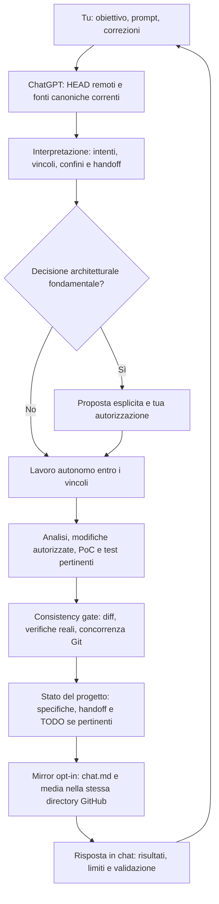

# Chat mirror — GitHub

- **Data di attivazione:** 14 ottobre 2026
- **Modalità:** esplicita per questa chat; aggiornamento GitHub a ogni scambio
- **Archivio:** Markdown e immagini collegate nella stessa directory
- **Ambito:** dall’attivazione in poi (nessun backfill)

---

### 👤 Utente — 14 ottobre 2026

attiva il mirror su questa chat adesso.

### ✨ ChatGPT — 14 ottobre 2026

**Mirror attivo in questa chat.** Ho creato [il documento Markdown su GitHub](https://github.com/massimilianonardi-ai/rumiai-dev/blob/main/chats/2026-10-14-github-chat-mirror/chat.md) nella directory `rumiai-dev/chats/2026-10-14-github-chat-mirror/`.

Da questo messaggio in poi registrerò ogni tuo prompt e la mia risposta in `chat.md`, direttamente su GitHub, con un commit per ogni scambio. Le eventuali immagini saranno salvate nella stessa directory e collegate con percorsi relativi. Se una sincronizzazione fallisce, te lo segnalerò.

Gli scambi precedenti all’attivazione non sono stati copiati. Per interrompere il mirror, scrivi **«Disattiva il mirror»**.

---

### 👤 Utente — 14 ottobre 2026

prima dice: È emersa inoltre una regola documentale corrente sulla conservazione delle chat che dovremo riallineare prima di iniziare ad archiviarle permanentemente. a cosa ti riferivi?

### ✨ ChatGPT — 14 ottobre 2026

Mi riferivo a una regola interna di **`rumiai-dev/RULES.md`**, nella sezione *Documentation model*. Prima del riallineamento prevedeva che le vecchie chat, come i documenti superati e le analisi esplorative, fossero rimosse dall'albero corrente del repository una volta trasferite le informazioni utili nelle fonti canoniche. La cronologia Git ne avrebbe comunque conservato il contenuto.

Questa regola serviva a evitare che **trascrizioni storiche e decisioni superate venissero scambiate per specifiche attuali**. Non era un limite tecnico di GitHub né un divieto di archiviare conversazioni.

La tua richiesta introduce una distinzione importante: le chat salvate volontariamente in `rumiai-dev/chats/` devono **rimanere consultabili come archivio**, senza acquisire autorità sulle specifiche di RumiAI.

**Ho già risolto il conflitto quando abbiamo attivato il mirror:** ho aggiornato `RULES.md` per consentire esplicitamente gli archivi delle chat attivati dall'utente, chiarendo che sono *non normativi*. Ho aggiornato anche il `README.md` e l'handoff `workflow-optimization`. Puoi vedere la modifica in [questo commit](https://github.com/massimilianonardi-ai/rumiai-dev/commit/80e10e3f7353a6940b2cfd7e8b4bf52f5c57eb1f).

Quindi **non c'è più nulla da riallineare su questo punto**: il mirror può restare in `chats/` senza interferire con la knowledge base corrente.

---

### 👤 Utente — 14 ottobre 2026

puoi farmi un grafico del workflow attuale di interazione tra di noi?

### ✨ ChatGPT — 14 ottobre 2026

Ecco il **workflow attuale della nostra collaborazione su RumiAI**, comprensivo del mirror attivato in questa chat.

La distinzione importante è che **tu mantieni il controllo delle decisioni fondamentali**, mentre io posso analizzare ed eseguire autonomamente le attività all'interno dei confini approvati. Prima di intervenire verifico gli HEAD remoti e la documentazione corrente; dopo una modifica applico il consistency gate e aggiorno lo stato persistente pertinente.

**Su GitHub esistono due responsabilità diverse:** specifiche, handoff e TODO rappresentano lo stato corrente del progetto; il mirror in `chats/` conserva la conversazione ma non ha autorità normativa. La risposta viene registrata nel mirror prima di essere mostrata qui.

Il diagramma Mermaid è riprodotto nel [Markdown della chat](https://github.com/massimilianonardi-ai/rumiai-dev/blob/main/chats/2026-10-14-github-chat-mirror/chat.md) e viene renderizzato graficamente da GitHub. L'immagine illustrativa generata in ChatGPT non è stata salvata come file identico: la sua esportazione resta un limite da validare.
