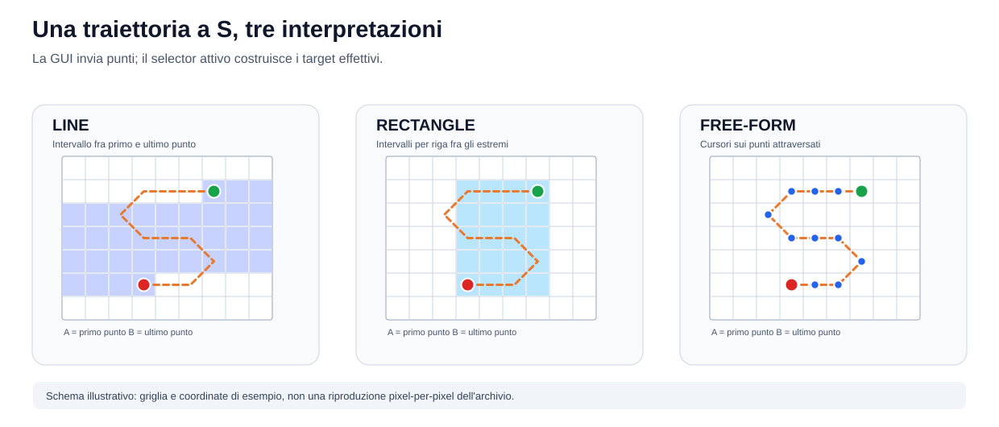
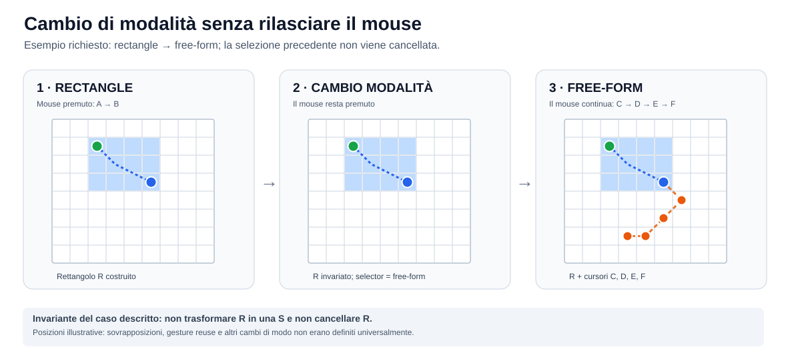
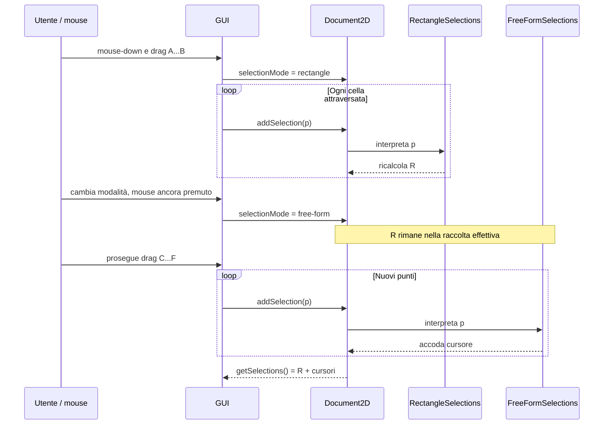
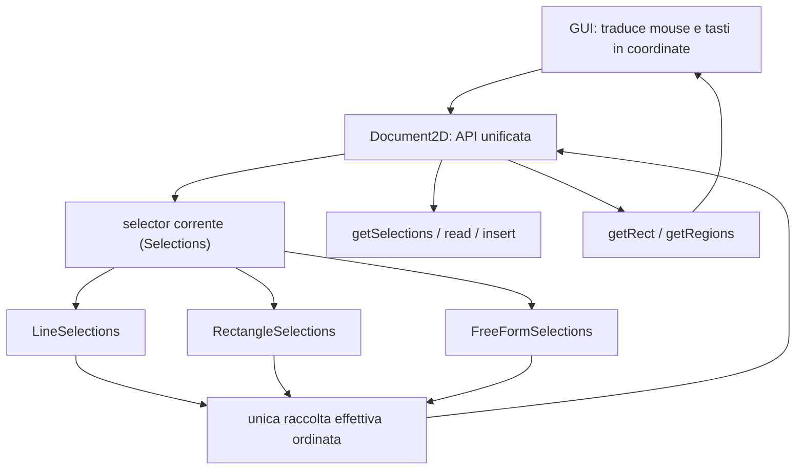

# TextEdit — storia ragionata della progettazione e delle decisioni (2026)

> **Ricostruzione storica, non specifica normativa.** Questo documento è una lettura cronologica degli archivi HTML della directory `chats/js text edit/`, richiesta per conservare il ragionamento, gli esempi e le correzioni maturati nelle conversazioni. Non modifica né sostituisce il contratto corrente in [`specifications/rumiai-os/TEXT-EDIT.md`](../../specifications/rumiai-os/TEXT-EDIT.md), le regole di sviluppo o lo stato operativo dell'[handoff `browser-column-editor.md`](../../handoff/browser-column-editor.md). In particolare, proposte, scelte temporanee e comportamenti soltanto sperimentati **non** sono automaticamente obblighi della libreria corrente.

**Data di redazione:** 5 novembre 2026. **Fonte:** sei esportazioni offline denominate `js edit` ... `js edit 6`; lettura degli `index.html` e dei rispettivi `audit.json` alla revisione del repository verificata prima della stesura. I riferimenti `A1:T51` indicano **archivio A1, turno catturato 51**, non un numero di riga o un link diretto al messaggio.

## 1. Fonti, metodo e limiti

| Sigla | Archivio HTML originale | Turni catturati | Note sulla copertura |
|---|---|---:|---|
| A1 | [`2026-10-14 js edit/index.html`](./2026-10-14%20js%20edit/index.html) | 65, ordinali 1–66 | Ordinale 62 mancante |
| A2 | [`2026-10-19 js edit 2/index.html`](./2026-10-19%20js%20edit%202/index.html) | 38 | Nessun ordinale mancante rilevato |
| A3 | [`2026-11-03 js edit 3/index.html`](./2026-11-03%20js%20edit%203/index.html) | 20 | Nessun ordinale mancante rilevato |
| A4 | [`2026-11-03 js edit 4/index.html`](./2026-11-03%20js%20edit%204/index.html) | 36 | Nessun ordinale mancante rilevato |
| A5 | [`2026-11-04 js edit 5/index.html`](./2026-11-04%20js%20edit%205/index.html) | 39, ordinali 1–40 | Ordinale 10 mancante |
| A6 | [`2026-11-05 js edit 6/index.html`](./2026-11-05%20js%20edit%206/index.html) | 10 | Nessun ordinale mancante rilevato |

**Totale: 208 turni catturati.** I sei `audit.json` dichiarano `partial-offline-reconstruction` e `rawComparison.status = not-compared`: sono ricostruzioni DOM, non un esportato RAW integrale verificato. Non preservano il comportamento interattivo React e non garantiscono che ogni evento o risorsa della conversazione originale sia presente. La prima chat catturata comincia con un *prompt di ripresa* di una conversazione già precedente, che **non** viene quindi ricostruita arbitrariamente in questo documento. Indicazioni temporali relative come “Today”/“Yesterday” appartengono alla schermata acquisita: quando la data esatta non è autonoma, si usa l'ordine degli archivi e dei turni.

Il documento distingue sistematicamente:

- **Richiesta esplicita:** quanto specificato o corretto dall'utente nei turni riportati.
- **Accordo/decisione:** proposta recepita e seguita da una conferma esplicita o da un'azione autorizzata nei turni successivi.
- **Risultato dichiarato/verificato nella chat:** implementazione o test riportati dall'assistente e, ove presente, riscontro dell'operatore; non equivale a ripetere oggi quella validazione.
- **Ipotesi o questione aperta:** alternative e semantiche volutamente non fissate.

Le immagini SVG allegate sono **disegni esplicativi originali**, costruiti da queste descrizioni testuali. Le coordinate usate nelle figure sono esempi: non pretendono di ricostruire la traiettoria pixel-per-pixel di un mouse reale.

## 2. Obiettivo di progetto e confini che emergono dalle chat

L'obiettivo è un **editor JavaScript avanzato**, veloce anche su documenti enormi, con gestione robusta del dato, editing non lineare e per colonne, selezioni multiple/creative, visualizzazioni composte (grafemi, TAB, folding, annotazioni, sostituzioni) e una GUI browser leggera, eventualmente ospitata da Electron. MadEdit-Mod è citato come riferimento per **interazioni** intuitive, non come contratto di compatibilità indistinta.

Il percorso di progettazione cerca di tenere separate quattro domande: **dove risiede il testo esatto?** (`Document` e storage); **quali coordinate, regioni e contenuti espone una vista?** (`Document2D` e livelli di trasformazione); **come una sequenza di punti produce una raccolta di selezioni?** (strategie `Selections`); **come mouse, tastiera, appunti e pixel comunicano con il modello?** (GUI/adapter di input). L'utente interviene ripetutamente per impedire che una dimostrazione funzionante venga scambiata per architettura definitiva, o che l'implementazione costringa la GUI a conoscere i dettagli del motore. [A1:T3–T13; A1:T43–T55; A2:T3–T12; A4:T19–T26]

## 3. Cronologia dettagliata

### 3.1. 14 ottobre: base TextEdit 0.8.2 e modello unico delle selezioni (A1:T1–T4)

La prima esportazione si apre con il riepilogo di una fase precedente: **TextEdit 0.8.2** ha un motore indipendente dalla GUI; ogni selezione ordinaria è rappresentata da estremi `start`, `end` e orientamento `forward`. Le selezioni possono essere multiple, ordinate e orientate indipendentemente. **Una selezione rettangolare non richiede un tipo persistente “rettangolo”**: è una raccolta ordinata di selezioni normali. Dopo una sostituzione, restano cursori riutilizzabili; gli inserimenti orientati all'indietro possono applicare la trasformazione del payload per grafemi a livello input, mentre il motore garantisce posizioni e commit. Le politiche geometriche `virtual` e `clipped` sono distinte dalla semantica dell'inserimento. [A1:T1]

L'utente precisa che la versione era già stata provata con un risultato soddisfacente: **non bisogna ripetere il lavoro né presumere che i TAB siano un problema isolato**. Un TAB introduce la questione più generale di elementi visuali che occupano più celle o intersecano regioni bidimensionali. La nuova attività deve inventariare ciò che è nel motore, ciò che appartiene alla GUI e ciò che necessita di un modulo autonomo. [A1:T3; risposta T4]

### 3.2. 14–17 ottobre: regioni 2D, primo esperimento e critica al riuso (A1:T5–T12)

Si separa un esperimento in `region-geometry.js` del PoC 066: descrizione delle regioni, geometria logica e selezioni 2D vengono sottratte al DOM, mentre il browser mantiene rendering, mouse, tastiera e pixel. Si producono grafici del flusso di codice e dei sorgenti. I problemi esemplificativi sono: TAB che occupa più celle per un singolo carattere, folding che nasconde testo sorgente, annotazioni che occupano spazio senza testo modificabile, regioni parzialmente intersecate. [A1:T5–T10]

L'utente giudica positivamente il **comportamento** sperimentale ma segnala un difetto **implementativo**: il PoC ricostruisce responsabilità già stabilizzate in TextEdit. La risposta riconosce la duplicazione e la necessità di riusare mappatura, grafemi, TAB, ancoraggi e modifica atomica prima di estendere il modello visuale. Non viene autorizzata una modifica “opportunistica” al rilascio 0.8.2. [A1:T11–T12]

### 3.3. 14–19 ottobre: estrazione leggibile del core, identità nominale e ciclo di vita (A1:T13–T40)

L'utente chiede di **non toccare mai TextEdit 0.8.2** durante l'estrazione e di creare sorgenti autonomi sotto `m.text.document` e `m.text.selection`, da studiare direttamente. Richiede esplicitamente formattazione conforme alle proprie regole, separazione visiva di funzioni e metodi, commenti nei passaggi significativi e un file JS per classe esposta. [A1:T13–T18; T23]

La prima estrazione separa `FlatDocument`, `PieceDocument` e le primitive di storage; poi viene corretta la gerarchia: un'interfaccia soltanto *strutturale* non consente di verificare `instanceof`. Il nuovo core introduce la classe astratta nominale `Document`, `_DocumentStore` come base comune, e `FlatDocument`/`PieceDocument` come sottoclassi; la libreria standalone rimane indipendente. [A1:T19–T24]

La discussione su `TextEditSelections` passa dall'uso ripetuto di controlli “alive” a un `destroy()` esplicito (in luogo di `dispose()` nel **nuovo core**), con disiscrizione, nullificazione dei riferimenti interni e gestione innocua delle notifiche tardive da `#committed()`. Vengono considerate e scartate alternative come manipolare il prototype o introdurre un `Proxy`: la distruzione JavaScript non è un distruttore C++ deterministico. I test dichiarati coprono l'uso dopo la distruzione, i documenti condivisi e le notifiche. [A1:T25–T34]

La spiegazione degli **anchor** chiarisce che non sono pezzi di testo: sono riferimenti per ricalcolare le selezioni dopo modifiche, distinti dalla raccolta effettiva `{row,col}`. Per posizioni esistenti possono usare offset lineari; per colonne oltre EOL o righe oltre EOF devono rappresentare posizioni virtuali (`real`, `column`, `future`). Lo stato ausiliario di rebasing non costituisce una seconda raccolta autorevole di selezioni. [A1:T35–T40]

### 3.4. 17–19 ottobre: la GUI non deve sapere che cosa c'è dietro `Document2D` (A1:T41–T50)

L'utente rifiuta una GUI che debba distinguere il documento “fisico”, “raw”, virtuale o logico, e propone un'interfaccia unificata **`Document2D`**. L'origine reale del contenuto può essere un file, un documento trasformato o una catena di viste: il consumer vede soltanto le coordinate e i comportamenti **dello spazio 2D che gli è stato passato**. `Document2D` non è semplicemente `Document` con un'altra geometria né deve esporre il motore di storage. [A1:T43–T48]

Sono individuate operazioni semantiche, non eventi del browser: leggere un rettangolo visibile, ottenere/gestire selezioni, interpretare testo in ingresso, notificare revisioni e distruggere una vista. Gli eventi del mouse/tastiera vengono tradotti dalla GUI in coordinate/richieste; **l'interpretazione della geometria di selezione appartiene a `Document2D` e ai relativi gestori**. Clipboard e trasporto di sistema restano fuori dal documento. [A1:T49–T50]

### 3.5. 19 ottobre: l'esperimento della “S”, modalità e API estensibili (A1:T51–T56)

Questo è il nucleo della progettazione richiesta dall'utente, trattato più estesamente nella [sezione 5](#5-selezioni-avanzate-lesempio-originale-della-s).

L'utente descrive un drag nel quale, all'ingresso del mouse in ogni **carattere/cella logica visualizzata**, la GUI chiama `addSelection({row,col})`: la sequenza disegna una “S”. **La GUI non calcola una selezione a S**; invia punti. Con `selectionMode = line` il gestore prende i due estremi della traiettoria; con `rectangle` li interpreta come vertici opposti; con `free-form` costruisce una costellazione di cursori sui punti attraversati. [A1:T51–T52]

La successiva precisazione è fondamentale: `addSelection()` e `remSelection()` **possono ristrutturare interamente** le selezioni esistenti; non sono inserimenti o rimozioni obbligatorie di un singolo record. La dimensione dell'elemento attraversato dipende dalla modalità: il `free-form` descritto produce cursori zero-length, mentre un ipotetico `free-form2` produrrebbe intervalli di una cella. Si immagina `Document2D` che selezioni un gestore `Selections` registrato mediante `selectionMode`, e un analogo interprete dell'input scelto con `insertMode`. La lettura visuale limitata viene ripensata come `getRect(rowStart,colStart,rowEnd,colEnd)` per permettere virtualizzazione sia orizzontale sia verticale. [A1:T53–T54]

**Caso di cambio in corsa richiesto direttamente dall'utente:** mouse sempre premuto; mentre si trascina è attivo `rectangle`, poi la modalità cambia in `free-form`; **il rettangolo precedente resta, e i punti successivi aggiungono cursori alla coda della raccolta**. L'utente rinvia esplicitamente la definizione generale delle altre transizioni. Non viene chiesto di convertire il rettangolo in una forma a S, né di azzerarlo al cambio di modalità. L'assistente recepisce questo caso specifico senza pretendere una regola universale per ogni transizione. [A1:T55–T56]

### 3.6. 19 ottobre: interfacce e primi gestori concreti (A1:T57–T66)

Su autorizzazione, viene introdotta `Selections`, interfaccia astratta nominale con **quattro** operazioni: `getSelections()`, `setSelections(selections)`, `addSelection(position)` e `remSelection(position)`. `selectionMode` rimane proprietà del documento/coordinatore, non della singola strategia. [A1:T56–T58]

Vengono quindi realizzate nel core separato `LineSelections`, `RectangleSelections` e `FreeFormSelections`, con una base di implementazione interna `_ModeSelections`. L'assistente riferisce test delle tre modalità, delle orientazioni inverse, di rimozioni, modifiche esterne e della composizione **rectangle → free-form** che conserva il rettangolo e aggiunge cursori. Tutti i gestori operano su **un'unica raccolta effettiva**; il singolo gestore conserva soltanto lo stato interpretativo temporaneo del proprio gesto. [A1:T59–T60]

Segue l'interfaccia astratta `m.text.document.Document2D`: non deriva da `Document`; espone fra l'altro `getRect`, `read`, selezioni, `selectionMode`, `insertMode`, `insert`, `subscribe` e `destroy`. Infine viene realizzato `RawDocument2D` da un `Document` lineare, testato con `FlatDocument` e `PieceDocument`. **Sostituisce l'accesso esplicito a `TextEditSelections` da parte della GUI, ma riutilizza internamente quella classe** per non duplicare le garanzie di rebasing e commit atomico. Non è una decisione di cancellare fisicamente `TextEditSelections`. [A1:T61–T66]

### 3.7. 19 ottobre–2 novembre: scomposizione di `TextEditRepresentation` (A2:T1–T12)

Il nuovo archivio riparte dal primo `RawDocument2D` funzionante. L'utente chiede l'inventario delle responsabilità passate e future di `TextEditRepresentation`: proiezione e sostituzioni, mapping sorgente↔vista, segmentazione Unicode, geometria delle colonne, annotazioni, invalidazione dopo commit, selezioni e ciclo di vita. [A2:T1–T4]

L'utente afferma che **atomicità e sincronizzazione visibile** sono garanzie comuni che `Document2D` deve rispettare; la trasformazione tra rappresentazioni è un'altra responsabilità. Vengono considerati un wrapper/basamento (`AtomicDocument2D`, `SynchDocument2D`, provvisoriamente `DerivedDocument2D`) e una possibile interfaccia `Representation`. L'utente preferisce il nome **`BaseDocument2D`**, ma conclude che **non occorre introdurla senza un caso pratico**: per ora il comportamento comune può rimanere nelle implementazioni esistenti. La risposta concorda sul rinvio. [A2:T5–T10]

La formulazione consolidata del problema non è “aggiungere o togliere caratteri”: **una vista `Document2D` trasforma regioni di uno spazio 2D in regioni di un altro spazio 2D**, conservando corrispondenze sufficienti a lettura, selezione, modifica e notifiche. TAB e grafemi possono condividere alcuni aspetti geometrici ma non sono automaticamente identici a folding/annotazioni; una singola classe generica prematura rischierebbe di nascondere differenze importanti. Si decide di verificare l'utilità delle astrazioni attraverso casi concreti invece che introdurle subito. [A2:T7–T12]

### 3.8. 2–3 novembre: PoC 074 e implementazioni di rappresentazioni composte (A2:T13–T38)

Il PoC 074 `Document2D Stack` viene valutato come **prova di fattibilità**, non come sorgente da copiare integralmente: il principio convincente è una sequenza di viste, ciascuna con un proprio spazio 2D, che traduce all'indietro gli edit fino a **un solo commit fisico**. L'utente approva di procedere nel core `rumiai-os/lib/sys/js/core/m/text`. [A2:T13–T23]

Gli incrementi riferiti nei turni successivi sono:

1. **`CellDocument2D`**: grafemi e TAB come unità/celle logiche; letture e modifiche composte senza richiedere alla GUI conoscenza di UTF-16. [A2:T20–T24]
2. **`FoldDocument2D`**: prima folding di righe intere, poi folding *inline* tra prefisso/suffisso di righe, con marcatore sintetico e rifiuto di edit che attraversano materiale nascosto. [A2:T25–T30]
3. **`AnnotationDocument2D`**: annotazioni additive e senza occupazione di celle, distinte dal testo editabile; mantenimento attraverso composizioni, con protezioni conservatrici. [A2:T27–T28]
4. **Editing atomico comune**: estrazione interna del coordinamento `Document2D._replaceMapped()`; il mapping geometrico specifico rimane nei singoli adattatori. Non viene introdotta una nuova interfaccia pubblica generica. [A2:T31–T32]
5. **`SubstitutionDocument2D`**: regioni sintetiche protette di larghezza variabile, più intervalli disgiunti, poi casi derivati da sorgenti non contigue o riusate. Una corrispondenza molti-a-molti non rende automaticamente editabile una regione ambigua. [A2:T33–T36]
6. **Geometria degli edit `old/new`**: il documento fisico pubblica dopo il commit informazioni della geometria prima e dopo la modifica, senza tentare di ricostruire la geometria precedente da uno stato già mutato. [A2:T37–T38]

Le risposte attestano progressivamente test permanenti/CI sui backend Flat e Piece. Sono **checkpoint storici riferiti a revisioni dell'epoca**, non test rieseguiti per questa ricostruzione. Il mantenimento automatico di tutti i fold e le annotazioni dopo modifiche esterne non era ancora genericamente dimostrato alla fine di A2.

### 3.9. 3 novembre: propagazione della geometria e protezione degli anchor (A3:T1–T20)

La terza chat è un ciclo di incrementi con ripetuti “procedi”. La sequenza dichiarata è:

1. `RawDocument2D` → `CellDocument2D`: calcolare gli estremi delle modifiche nella geometria grapheme/TAB **precedente e successiva**, evitando risultati parziali o inventati. [A3:T1–T2]
2. Propagazione attraverso uno o più livelli `AnnotationDocument2D` senza confondere modifiche al contenuto con aggiornamenti di overlay. [A3:T3–T4]
3. **Conservazione selettiva** degli anchor di annotazione quando la corrispondenza è dimostrabile; invalidazione quando edit, TAB, grapheme o nuova disposizione rendono ambigua la posizione. Non basta traslare ingenuamente tutte le colonne. [A3:T5–T6]
4. Propagazione controllata di geometria attraverso `FoldDocument2D` e `SubstitutionDocument2D`: maggiore prudenza per marker, contenuti nascosti, bordi di sostituzione e coordinate non verificabili. [A3:T7–T10]
5. Osservazione **pre-commit** per fold inline e sostituzioni con estremi non coincidenti con quelli inizialmente noti; confronto autorevole con l'evento di commit. [A3:T11–T14]
6. Propagazione pre-commit attraverso `CellDocument2D` e `AnnotationDocument2D`, poi prime composizioni annidate più articolate; i limiti non dimostrati mantengono l'invalidazione conservativa. [A3:T15–T20]

Il principio ricorrente è che **geometria dell'edit** e **persistenza dell'identità di un anchor/overlay** sono prove diverse. Un evento può descrivere correttamente la modifica senza autorizzare il ripristino di un fold o di un'annotazione. L'integrità del testo ha precedenza sull'apparente continuità visiva.

### 3.10. 3–4 novembre: fermare la crescita del motore e usare la GUI come prova del contratto (A4:T1–T26)

La quarta chat prosegue con composizioni come `CellDocument2D` sopra `CellDocument2D`, poi catene con annotazione, fold e sostituzione, verificando per ciascun livello le coordinate *old* e *new* e conservando fallback sicuri. [A4:T1–T10]

L'operatore prova una prima GUI su Ubuntu x64 e segnala problemi di ambiente e usabilità: Node assente, emoji tagliata, frecce che sembrano muovere il contenitore e impossibilità apparente di editare il testo. Seguono correzioni/prove: l'utente conferma il successo degli scenari richiesti, **ma non considera la GUI un prodotto finito**. Formula allora una svolta: fermare temporaneamente l'espansione del motore che ha dimostrato di funzionare e costruire una GUI di test sempre più concreta, consumatrice **soltanto di `Document2D`**, per verificare dall'esterno l'adeguatezza del contratto. [A4:T11–T20]

Si chiarisce il confine tra `RawDocument2D` e `CellDocument2D`. Il primo espone coordinate/unità **UTF-16**; il secondo espone confini dei **grafemi** e TAB con ampiezza logica in celle. Non è sufficiente che il browser renda bene una stringa: la GUI deve rispettare i confini dichiarati dal documento, misurare i pixel, ma **non re-segmentare Unicode** per inventare target di editing. Il caso `A😀B`, gli accenti combinati e le sequenze ZWJ rendono concreta la distinzione. [A4:T21–T26]

### 3.11. 4 novembre: prove Raw/Cell, formato compatto e problema ZWJ (A4:T27–T36; A5:T1–T8)

Nel PoC 066 viene provata la stessa GUI su dati Raw e Cell, con test Chromium reali: mouse, frecce, inserimento, regioni sintetiche protette, grafemi e TAB. Il test scopre anche un problema di misura dell'emoji in pixel, corretto nel renderer sperimentale. [A4:T27–T30]

Per sperimentare un output Raw suddiviso in unità individuali e non penalizzare memoria/trasporto, si confrontano **regioni esplicite**, output **aggregato** e forme **compatte** che dichiarano confini logici e UTF-16. Si misurano payload serializzati e poi heap; queste metriche **non** equivalgono a benchmark definitivi di RAM per file enormi. Una segmentazione troppo anticipata spezza la sequenza ZWJ `👩‍💻` durante la successiva composizione Cell. [A4:T31–T36]

La quinta chat verifica sperimentalmente una correzione della scansione incrementale Unicode, anche con confini di blocco e viste annidate; il prodotto rimane invariato. Vengono provati encoder compatti diretti e varianti ottimizzate. Nel benchmark citato per finestre di 4.096 colonne, il Raw aggregato risulta ancora più leggero delle varianti di trasporto, mentre le rappresentazioni granulari aumentano payload e heap. Non ne deriva l'obbligo di promuovere il codec compatto. [A5:T1–T8]

### 3.12. 4 novembre: richiamo alla priorità, contratto GUI–Document2D e piano G00–G07 (A5:T11–T26)

L'utente interrompe la deriva verso l'ottimizzazione del codec: **l'obiettivo attivo è completare il contratto tra GUI e `Document2D` e iniziare la GUI**. La risposta riconosce che i benchmark erano divenuti un obiettivo secondario. [A5:T11–T12]

Si decide pragmaticamente: **non riscrivere `RawDocument2D.getRegions()`**, non aggiungere un livello inferiore soltanto per atomizzare UTF-16, usare la catena canonica `Document → RawDocument2D → CellDocument2D` (eventualmente con altre trasformazioni) e lasciare alla GUI la sola presentazione delle unità pubbliche. La contrattualizzazione si valuta su interazioni **reali**, non su serializzazioni eleganti. [A5:T13–T14]

Viene chiesto, salvato e avviato un piano esecutivo **G00–G07** per il PoC 066. La successione è: inventario del contratto, pagina canonica indipendente da proxy Raw, puntatore/caret/tastiera, annotazioni/fold/sostituzioni protette, viewport limitata e ciclo di vita, analisi dei gap, hardening/confronto con GUI TextEdit 0.8.2, prova su host di riferimento. Le risposte dichiarano via via PASS Chromium per G01–G06; ciò dimostra solo gli scenari coperti, non tutte le capacità della futura GUI. [A5:T15–T26]

### 3.13. 4–5 novembre: prova sugli host, VM e validazione circoscritta (A5:T27–T40)

L'operatore avvia il test sulla **sua VM Ubuntu 26.04 ARM64**. Un controllo del launcher la blocca erroneamente in quanto macchina virtuale: l'utente corregge esplicitamente l'idea che virtualizzazione significhi non-validità, fissando l'ordine di massima validazione reale: VM Ubuntu 26.04 ARM64; VM Ubuntu 24.04/26.04 x86_64; macOS 27 ARM64. [A5:T27–T32]

Seguono problemi d'ambiente Chromium/NSS da non mascherare con modifiche di sicurezza non autorizzate; le prove proseguono dopo correzioni al percorso di test. Il rapporto della VM conferma **sei suite browser PASS** per il prototipo, con Chromium 157, Wayland, VMware, core e PoC revisionati. Sono risultati **specifici di quella macchina e di quelle revisioni**; non certificano automaticamente Electron, macOS, altri host, l'intera GUI o una sessione formale `rumiai-validate`. [A5:T33–T40]

### 3.14. 5 novembre: demo realmente interattiva e funzionalità avanzate del PoC (A6:T1–T10)

La sesta chat corregge un errore operativo: viene consigliato di eseguire lo script **x86_64** sulla già nota VM **ARM64**; il controllo dell'architettura lo rifiuta correttamente e il caso x86_64 resta **non eseguito**. [A6:T1–T4]

Un riepilogo separa motore pronto per il perimetro verificato e GUI ancora incompleta. L'utente osserva correttamente che un test automatico che apre e chiude il browser non gli consente di **vedere e usare** l'editor. Viene quindi creato uno script di demo che mantiene il server e apre/stampa la pagina canonica del PoC 066. [A6:T5–T8]

Infine l'utente restringe il lavoro a due obiettivi: **GUI** (rettangoli, trascinamento, clipboard, IME, navigazione, scrollbar) e **funzioni avanzate** (copy/paste per colonne, undo/redo, interazioni ispirate a MadEdit-Mod). La risposta riferisce implementazione sperimentale, correzioni e PASS Chromium del percorso avanzato su Flat/Piece. La cronologia dell'archivio **si arresta qui**: non si attribuisce a questo materiale una promozione delle funzioni nel prodotto o una validazione manuale nativa completa. [A6:T9–T10]

## 4. Registro sintetico delle decisioni storiche e dei confini

| Tema | Scelta/riscontro emerso | Stato nella conversazione e riferimento |
|---|---|---|
| Storage | `Document` nominale nel nuovo core; `FlatDocument` e `PieceDocument`; edit fisici atomici | Attuato nel core separato; A1:T19–T24 |
| Motore stabile | Non cambiare TextEdit 0.8.2 durante l'estrazione e la sperimentazione core | Vincolo ripetuto; A1:T13, T21; A2:T38 |
| Selezioni effettive | Una raccolta ordinata e orientata, non tipologie persistenti “line/rectangle” | Principio approvato; A1:T1, T51–T60 |
| Interprete del gesto | `Selections` a quattro metodi; `add/rem` possono ricalcolare la raccolta | Proposto, approvato e implementato; A1:T53–T60 |
| Gestori iniziali | `LineSelections`, `RectangleSelections`, `FreeFormSelections` | Implementazione/test riportati; A1:T59–T60 |
| Traccia a S | Stessi punti in input, risultati diversi secondo il selector | Richiesta esplicita; A1:T51–T54 |
| Switch nel drag | `rectangle → free-form` preserva rettangolo e accoda cursori | Caso richiesto e testato; A1:T55–T60 |
| Altri cambi modo | Gestione universale di switch/re-entry/rimozioni non fissata | Esplicitamente rinviata; A1:T55–T56 |
| `Document2D` | Contratto verso la GUI, indipendente dalla natura della vista | Requisito corretto dall'utente; A1:T43–T50 |
| Rendering | I pixel sono della GUI; unità, confini e coordinate della vista sono del `Document2D` | Corretto e sperimentato; A4:T21–T28 |
| Storage vs vista | `RawDocument2D` adattatore su `Document`; `CellDocument2D` per grafemi/TAB | Attuato con composizione; A1:T65–T66; A2:T20–T24 |
| Trasformazioni | Fold, annotazioni e sostituzioni componibili; regioni sintetiche protette | Incrementi testati, con limiti; A2:T25–T36 |
| Atomicità | Un edit logico non diventa una sequenza di commit fisici parziali | Requisito confermato; A2:T5–T12, T31–T38 |
| Astrazione comune | `BaseDocument2D` e `Representation` solo se risolvono un riuso reale | Introduzione rinviata; A2:T7–T12, T30–T36 |
| Codec Raw | Mantenere output Raw aggregato; benchmark/codec non bloccano GUI | Correzione di priorità; A5:T11–T16 |
| GUI PoC | Provare contratto con browser reale e `Document2D` canonico | G00–G06 dichiarati completati; A5:T15–T26 |
| Host | VM Ubuntu ARM64 è host di riferimento valido; altri host non surrogabili da CI | Correzione utente; A5:T31–T40 |
| Funzioni avanzate | Rettangolo, colonne, clipboard, IME, history e scrollbar nel PoC | Sperimentazione, non release; A6:T9–T10 |

## 5. Selezioni avanzate: l'esempio originale della “S”

Questa sezione ricostruisce **il comportamento desiderato dalla persona che ha progettato l'editor**, distinguendo il caso concretamente accettato dalle estensioni che le chat lasciavano aperte.

### 5.1. La “S” è il percorso di input, non una classe di selezione

Il caso originale descrive il mouse che attraversa varie celle logiche e disegna sullo schermo una **S**. In ogni attraversamento la GUI invia una coordinata a `addSelection({row,col})`, nel **sistema di coordinate del `Document2D` esposto**. La GUI non calcola un intervallo lineare, un rettangolo o una lista finale di cursori: il *selector* attivo interpreta la sequenza. [A1:T51–T54]

Sia una successione concettuale `P = [p0, p1, …, pn]`. La forma geometrica completa della S è identica nei tre pannelli, ma cambia l'**output** della strategia:



**Diagramma 1:** esempio originale ridisegnato come griglia logica, non screenshot del PoC né definizione di inclusività dei confini.

| Modalità selezionata | Input osservato dal gestore | Output desiderato |
|---|---|---|
| `line` | Primo punto `p0`, ultimo punto corrente `pn`; i punti intermedi aggiornano l'estensione ma non diventano “isole” permanenti | **Un normale intervallo lineare** tra gli estremi, rappresentato da una selezione ordinaria |
| `rectangle` | `p0` e `pn` come angoli opposti dell'ingombro corrente | **Più intervalli ordinari**, uno per riga del rettangolo, in ordine/orientamento coerente con il verso del gesto |
| `free-form` | Ogni posizione logica visitata, nel suo ordine | **Cursori a lunghezza zero** sui punti attraversati (la S diventa una traiettoria di destinazioni, non un'evidenziazione continua) |
| `free-form2` | Stesso flusso delle coordinate | **Ipotesi illustrativa**, selezione di una cella per punto, non quarta classe consolidata nella chat |

**Correzione storica importante:** una prima illustrazione dell'assistente descriveva `line` come selezione “dalla prima all'ultima riga”; lo stesso assistente precisa poco dopo che l'effetto è **l'intervallo lineare fra gli estremi**, non necessariamente intere righe. Il disegno sopra usa la formulazione corretta. [A1:T52]

### 5.2. Non è una raccolta di pixel: che cosa arriva da una GUI

Nella descrizione originale il punto si genera **quando il mouse entra in un carattere/cella logica**. La GUI conosce solo i dati del gesto e lo spazio visualizzato; può usare le regioni pubblicate da `Document2D` per individuare i confini validi. Non deve scegliere arbitrariamente punti **interni** a grapheme, TAB o contenuti sintetici indivisibili e non deve confondere un pixel con una colonna logica o un offset UTF-16. [A1:T51; A4:T21–T26]

Le chat non stabiliscono una regola universale per interpolare tutti i punti mancanti in caso di eventi del mouse radi, per penna/touch, velocità elevate o salto di molte celle fra due eventi. Analogamente non fissano una gestione universale delle celle ripassate più volte. L'implementazione del primo `FreeFormSelections` viene descritta come capace di conservare cursori distinti nell'ordine di visita; **non** ne segue che ogni futuro selector debba deduplicare gli stessi punti. [A1:T53–T60]

### 5.3. Mentre si disegna, la selezione può restringersi o cambiare forma

Per `line` e `rectangle` non si deve semplicemente **aggiungere** a ogni `addSelection` il risultato del fotogramma precedente: occorre ricordare almeno **ancora iniziale** e **ultimo punto** del gesto, ricostruendo la selezione corrente. Se il mouse torna indietro, l'intervallo o il rettangolo si restringono. In `free-form`, invece, i punti intermedi fanno parte dell'informazione che si intende conservare. [A1:T51–T54]

Questo spiega perché:

- `addSelection()` **non promette** di incrementare di uno la lunghezza dell'array delle selezioni;
- `remSelection()` **non promette** di cancellare sempre un singolo record: la sua interpretazione dipende dal selector;
- lo stato transitorio della traiettoria (`p0`, ultimo punto, punti visitati) non deve confondersi con la **raccolta effettiva** usata da lettura e modifica del documento.

L'assistente pose apertamente la domanda se `remSelection()` dovesse cancellare una visita, togliere un punto, far tornare indietro il gesto o cambiare l'estremo: **non tutte queste semantiche furono approvate in modo generale**. [A1:T52–T56]

### 5.4. Il caso decisivo: cambiare da `rectangle` a `free-form` senza rilasciare il pulsante

La richiesta del turno **A1:T55** non si limita a “consentire più modalità”. Introduce un comportamento compositivo durante **un solo drag continuo**:

1. **Mouse premuto, modalità `rectangle`.** Un primo punto `A` ancora il gesto; i punti successivi portano a `B`. Il selector costruisce una raccolta `R = [r1, r2, …]` di intervalli di riga che rappresentano il rettangolo al momento del cambio.
2. **Senza `mouseup`, cambia `selectionMode` in `free-form`.** Il risultato `R` **rimane nella raccolta effettiva**; il cambio modalità non lo trasforma né lo cancella. Il nuovo selector comincia a interpretare le coordinate **successive**.
3. **Il mouse continua la traiettoria (`C, D, E, F…`).** Per ciascun nuovo punto il selector free-form costruisce uno o più cursori zero-length, che si **accodano** alle normali selezioni già presenti.
4. **Risultato finale:** `R ⧺ [cursor(C), cursor(D), cursor(E), cursor(F), …]`, cioè **selezioni miste nella stessa raccolta ordinata**. `⧺` denota qui una concatenazione illustrativa, non una nuova API di prodotto.



**Diagramma 2:** tre momenti dello **stesso mouse-down**. Blu: rettangolo già esistente; arancione: nuovi cursori creati dopo lo switch. Le coordinate esemplificative servono a visualizzare la composizione, non fissano una politica generale di sovrapposizioni.

> **Elemento da non perdere nella futura implementazione:** la modalità è un **interprete delle operazioni successive**, non un'etichetta persistente che obblighi a rigenerare o eliminare tutte le selezioni correnti.

L'assistente del turno **A1:T56** recepisce precisamente questo requisito, chiarendo che il risultato non deve essere un oggetto “rettangolo+S”: deve essere un array di record di selezione **normali**. La risposta A1:T60 afferma poi che il comportamento **rectangle → free-form** è stato esercitato da test permanenti del core separato. Questo non equivale a dimostrare che ogni variante di cambio modalità durante qualunque drag GUI sia già risolta.

### 5.5. Sequenza di chiamate illustrativa

Questo pseudocodice conserva **la responsabilità semantica originale**, non pretende di documentare il wiring esatto dei browser event handler odierni:

```javascript
// Uno stesso mouse-down: nessuna ricostruzione nella GUI.
document.selectionMode = 'rectangle';
document.setSelections([]);
document.addSelection(A);
document.addSelection(B);          // costruzione/aggiornamento di R

// Il mouse resta premuto; l'utente cambia modalità.
document.selectionMode = 'free-form';

// Le coordinate successive producono cursori aggiuntivi.
document.addSelection(C);
document.addSelection(D);
document.addSelection(E);

// getSelections() deve poter esporre insieme R e i nuovi cursori.
// Nessuna istruzione elimina o converte R.
const mixed = document.getSelections();
```

Gli eventi *mouse down*, *pointer move*, cambio modalità e *mouse up* sono responsabilità dell'input adapter/GUI; le modalità, in questa progettazione, devono poter interpretare gli stessi punti senza API speciali per i rettangoli. Il disegno non deve dipendere dall'accesso a `TextEditSelections` o da offset del documento fisico. [A1:T49–T56]



### 5.6. Perché serve un'interfaccia `Selections` e non una selezione “di tipo rettangolo”

Il modello proposto e poi implementato evita che ogni modalità mantenga un **proprio documento di selezioni**. `Document2D` possiede/esporta uno stato coerente, i gestori sono strategie intercambiabili che leggono, impostano o ristrutturano quello stato. La forma normalizzata concettualmente riutilizzata dalla progettazione è:

```javascript
{
  start:   { row, col },
  end:     { row, col },
  forward: true // o false
}
```

Un cursore ha `start` ed `end` coincidenti; un rettangolo produce **più record**; un gesto misto mette insieme record provenienti da più interpretazioni senza una proprietà persistente `kind: 'rectangle'`. Ordine e orientamento sono importanti per leggere, copiare e inserire contenuti in più destinazioni. L'assistente propone anche la proprietà di round-trip `setSelections(getSelections())` indipendentemente dalla modalità attiva, utile a ripristinare raccolte miste: nel turno A1:T56 è **proposta di contratto**, non una prova universale per tutti gli stati immaginabili.



La freccia dal selector verso l'array indica il **ruolo logico di produzione/aggiornamento**, non un invito a creare tre proprietari concorrenti. La GUI non deve conoscere quale strategia o rappresentazione è dietro il `Document2D`.

### 5.7. Cambio di modalità: che cosa è determinato, e che cosa non lo è

| Scenario | Ricostruzione supportata dalle chat | Evidenza |
|---|---|---|
| `rectangle` mentre il mouse si muove | Primo/ultimo punto determinano un rettangolo aggiornabile, non la somma di tutti i rettangoli intermedi | A1:T51–T54 |
| `line` mentre il mouse si muove | Un intervallo tra gli estremi; se l'ultimo punto torna indietro il range si riduce | A1:T52 |
| `free-form` continuo | I punti visitati producono cursori zero-length; la traiettoria conta | A1:T51–T54 |
| **`rectangle → free-form` nello stesso drag** | **Conserva il rettangolo corrente e accoda i cursori successivi** | **A1:T55–T60** |
| `free-form → rectangle`, `line → free-form`, ritorno a una modalità precedentemente attiva | Non è definita una semantica universale per accumulo, riattivazione dello stato interno o conversione | A1:T55–T56 |
| `remSelection()` dopo più modalità o visite sovrapposte | Il gestore interpreta la richiesta; politica globale di rimozione/ripasso non fissata | A1:T52–T56 |
| Duplicati, sovrapposizioni e orientamento dopo cambi ripetuti | Questioni di policy più ampie restate aperte o limitate a specifici test | A1:T54–T60; handoff corrente |
| `free-form2` con selezione di una cella per punto | **Esempio di estensibilità**, non modalità consolidata | A1:T53–T54 |

Il principio **negativo** è tanto importante quanto quello positivo: nessuna delle chat autorizza a dedurre “ogni cambio di modalità resetta il gesto”, “ogni cambio fonde o converte automaticamente le selezioni”, oppure “tutti i gestori devono ricordare l'intera traiettoria precedente”. Il caso `rectangle → free-form` è il precedente esplicitamente descritto; generalizzarlo richiede decisioni aggiuntive.

### 5.8. `selectionMode` e `insertMode` restano indipendenti

`selectionMode` decide **come costruire i target**; `insertMode` decide **come interpretare e distribuire il contenuto**. Per tre selezioni/cursori e il payload `uno\ndue\ntre`, la discussione considera interpretazioni `raw`, `lines`, `csv`, `tsv`, ma le esatte regole di mismatch, ripetizione e incolla strutturato non sono state tutte fissate nell'esperimento della S. [A1:T51–T54]

Questo evita una dipendenza pericolosa: dopo una selezione rettangolare o mista, l'input non deve indovinare un “tipo di selezione” persistente; legge la raccolta ordinata dei target. Il **trasporto degli appunti di sistema** rimane compito esterno a `Document2D`. Le regole sperimentali del PoC 066 di novembre (es. una riga per target, ripetizione opzionale) sono **scelte locali di quella GUI**, da non retrodatare al contratto della S.

### 5.9. Geometria virtuale, Unicode e regioni protette

Le selezioni creative si applicano allo **spazio logico esposto**, non necessariamente al testo sorgente esistente. Una posizione oltre fine riga o fine documento può essere virtuale; scegliere di conservarla o tagliarla cambia la costruzione geometrica ma non deve scrivere testo durante il semplice movimento del mouse. La materializzazione fisica avviene quando richiesta da un'azione di edit, con un solo commit atomico. [A1:T1; A1:T35–T40; specifica corrente]

TAB e grapheme possono occupare più celle o più unità UTF-16: non è lecito trattare ciascun pixel attraversato come una destinazione modificabile. Folding e sostituzioni possono proteggere regioni e rendere ambigua la corrispondenza con la sorgente; annotazioni possono essere *source-less*. La composizione delle viste deve definire i confini validi e può rifiutare atomicamente un edit non mappabile. [A2:T25–T36; A4:T21–T26]

**Attenzione storica:** la discussione della S non definisce una politica universale di clipping, virtualità, TAB, grapheme, nesting e overlay per *tutti* i selector e *tutti* i cambi di modalità. Questi aspetti non vanno inventati per completare il disegno. La specifica corrente e i test delle implementazioni esistenti sono la fonte corretta per stabilire **oggi** quali casi siano veramente supportati.

## 6. Cosa la storia spiega e cosa non decide per il prodotto

La storia documenta soprattutto **un metodo di convergenza**:

1. Stabilizzare le proprietà sul dato (documento esatto, modifiche atomiche, selezioni effettive).
2. Definire confini nominali fra documento fisico, vista 2D, gestori di gesto, interpreti d'input e GUI.
3. Sperimentare in PoC ciò che è ancora aperto, senza promuovere prematuramente codec, alias o classi astratte.
4. Usare una GUI reale come test di sufficienza del contratto pubblico; correggere solo gap dimostrati.
5. Tenere separati PASS CI, test su VM di riferimento, uso manuale e validazione formale.

**Non prova** che sia già stato costruito un editor commerciale completo, che tutte le transizioni fra modalità siano definite, che `free-form2` sia rilasciata, che tutte le geometrie virtuali/annotate possano essere editate o che i benchmark del PoC stabiliscano prestazioni generali su file giganteschi.

### Rinvii autorevoli correnti (esterni alla cronologia)

- [Specifica corrente `TEXT-EDIT.md`](../../specifications/rumiai-os/TEXT-EDIT.md): semantica vigente dei documenti, selezioni, geometria e rappresentazioni.
- [Handoff attivo `browser-column-editor.md`](../../handoff/browser-column-editor.md): stato operativo, prove e questioni aperte **attuali**; è distinto da questa memoria storica.
- [`TESTING.md`](../../TESTING.md) e [`CONSISTENCY-GATE.md`](../../CONSISTENCY-GATE.md): livello di evidenza e procedure di riallineamento.

## 7. Indice delle evidenze più importanti, per un controllo diretto

- **Modello di selezioni unico e orientamento:** [A1](./2026-10-14%20js%20edit/index.html), T1, T41–T48.
- **Descrizione primaria della S e tre modalità:** [A1](./2026-10-14%20js%20edit/index.html), **T51** (utente), T52 (risposta).
- **`addSelection`/`remSelection`, `free-form2`, selector registrati, `getRect`:** [A1](./2026-10-14%20js%20edit/index.html), **T53** (utente), T54 (risposta).
- **Rettangolo che sopravvive allo switch `rectangle → free-form`:** [A1](./2026-10-14%20js%20edit/index.html), **T55** (utente), **T56** (accoglimento e limiti).
- **Implementazione dei tre gestori e test della composizione:** [A1](./2026-10-14%20js%20edit/index.html), T57–T60.
- **Interfaccia `Document2D`, `RawDocument2D` e separazione da `TextEditSelections`:** [A1](./2026-10-14%20js%20edit/index.html), T61–T66.
- **Regioni, astrazione proposta e rinvio di `BaseDocument2D`:** [A2](./2026-10-19%20js%20edit%202/index.html), T3–T12.
- **PoC 074, Cell/Fold/Annotation/Substitution e atomicità:** [A2](./2026-10-19%20js%20edit%202/index.html), T15–T38.
- **Geometria old/new, pre-commit e invalidazione prudente:** [A3](./2026-11-03%20js%20edit%203/index.html), T1–T20.
- **Richiesta di GUI di prova e separazione Raw/Cell:** [A4](./2026-11-03%20js%20edit%204/index.html), T19–T26.
- **Problemi di atomizzazione Unicode e trasporto compatto:** [A4](./2026-11-03%20js%20edit%204/index.html), T27–T36; [A5](./2026-11-04%20js%20edit%205/index.html), T1–T8.
- **Correzione della priorità e piano GUI G00–G07:** [A5](./2026-11-04%20js%20edit%205/index.html), T11–T26.
- **Validazione Ubuntu ARM64/VM e limiti:** [A5](./2026-11-04%20js%20edit%205/index.html), T27–T40.
- **Demo manuale e sviluppo delle funzioni avanzate nel PoC:** [A6](./2026-11-05%20js%20edit%206/index.html), T7–T10.

---

**Nota editoriale finale.** Il valore del caso della S è l'invariante di **composizione nel tempo**: lo stesso gesto può attraversare diverse strategie, ma ciò che è già stato costruito resta una raccolta di selezioni effettive riutilizzabile. È diverso dall'affermare che l'intera traiettoria debba essere continuamente reinterpretata dalla **modalità attualmente attiva**. La prima lettura è sostenuta esplicitamente da A1:T55–T60; la seconda non lo è.
